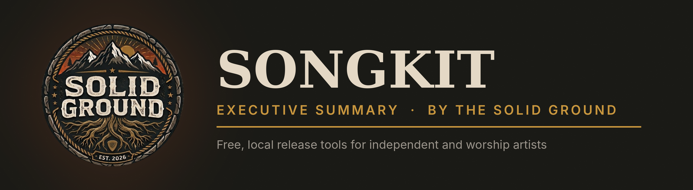
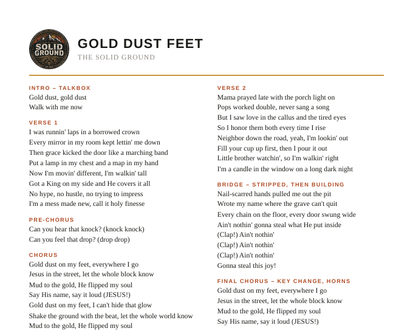

<p align="center"></p>

<p align="center">
<a href="https://songkit-solidground.netlify.app"><b>Website</b></a> &nbsp;·&nbsp;
<a href="README.md"><b>README</b></a> &nbsp;·&nbsp;
<a href="examples/gold-dust-feet"><b>Example song</b></a> &nbsp;·&nbsp;
<a href="LICENSE"><b>MIT License</b></a>
</p>

---

## The short version

**Songkit is a free, open-source app that turns a finished song into everything an independent artist needs to release it:**
synced lyrics, vertical lyric videos, a Spotify Canvas loop, and church-ready slides and lyric sheets.
It installs with one double-click, starts from a website button, and **runs entirely on the artist's own computer**,
so their music never gets uploaded anywhere.

> *Built on solid ground: your songs, your machine, your release.*

---

## The problem

Releasing a song today takes much more than the audio file.

- **Synced lyrics** on Spotify need a line-by-line timing file, and timing it by hand takes an hour or more.
- **Short-form video** (Reels, Shorts, TikTok) is how new songs get found, but captioned lyric clips usually mean an editor or a paid subscription.
- **Spotify Canvas**, the looping video behind a track, needs exact specs (vertical, 3 to 8 seconds, silent).
- **Worship songs** also need projection slides and printable lyric sheets for the band and the congregation.

Most tools that do this are cloud subscriptions that require uploading unreleased music. Small churches and indie artists often skip these steps entirely.

## The solution

One local app with four tabs, one for each release task:

| Step | What goes in | What comes out |
|---|---|---|
| **1 · Timed lyrics** | Vocal stem + lyrics | `.srt` and `.lrc`, auto-timed by Whisper (AI speech recognition) and editable in a table |
| **2 · Clips** | Song + a few background videos | 1080×1920 lyric clip with burned-in captions and an optional band badge |
| **3 · Spotify Canvas** | A background video | A silent, vertical 3–8 second loop |
| **4 · Church kit** | Lyrics | Slides for ProPresenter / EasyWorship and a print-ready lyric sheet |

Songs and outputs are saved by song name in `Documents\Songkit Songs`.

## How it works

```
 songkit-solidground.netlify.app          The artist's PC
 ┌──────────────────────────┐            ┌────────────────────────────────────┐
 │ Download  →  zip          │ ─────────► │ Install-Songkit (one time)         │
 │ 3-step instructions       │            │  • Python, ffmpeg, NVIDIA support  │
 │ ▶ Launch Songkit          │ ─songkit://► start.bat → Songkit app            │
 └──────────────────────────┘            │  • runs at 127.0.0.1 (local only)  │
                                         │  • CPU or GPU, never the cloud     │
                                         └────────────────────────────────────┘
```

- **Website (Netlify):** download, simple instructions, help answers, and a **Launch** button. It updates on its own from GitHub.
- **Installer (Windows):** installs everything needed, adds a desktop icon, and registers a `songkit://` link so the website can start the app.
- **App (Python + Gradio):** a browser-based interface served only on the user's own machine. Whisper handles lyric timing and ffmpeg handles video.

## Proof: *Gold Dust Feet*

The full workflow has been run end to end on a real song, a Christian hip-hop track by The Solid Ground.

<p align="center">
  
  &nbsp;
  
  &nbsp;
  
</p>

Timing file, 60-second lyric clip, Canvas loop, slides and lyric sheet: [`examples/gold-dust-feet`](examples/gold-dust-feet).

## Who it's for

- **Worship teams and church media volunteers** who need slides, lyric sheets and social clips without a budget.
- **Independent artists** releasing through DistroKid and similar distributors.
- **Creators using AI music tools** (Suno, Udio) who want polished release assets *and* honest disclosure.

## Principles

| | |
|---|---|
| **Private by design** | Audio and video are processed on the user's computer. Nothing is uploaded. |
| **Free and open** | MIT-licensed code; anyone can use, study or improve it. |
| **Built for non-technical users** | One installer, one Launch button, plain-language help, examples in every tab. |
| **Honest about AI** | Songkit makes release assets. It encourages disclosing AI use (for example DistroKid's AI Credits) and never hides how a song was made. |

## Status

- ✅ Live website with download, setup steps and launcher
- ✅ One-click Windows installer, tested end to end on Windows 11 with an NVIDIA GTX 1060
- ✅ All four tools used to produce the *Gold Dust Feet* example
- ✅ Editable lyric timing (fix or remove any line, then save), used to correct a line in the example
- 🔜 Mac installer (Mac/Linux currently run from the command line)
- 🔜 Direct Musixmatch export and more caption styles

## Built with

Python · Gradio · faster-whisper (OpenAI Whisper) · ffmpeg · Netlify · GitHub.
Example visuals made with Google Gemini (Veo and image generation).

---

<p align="center"><sub>
Songkit is made by <b>Josh Leonard / The Solid Ground</b> · Code: MIT · The Solid Ground name and logo: all rights reserved.
</sub></p>
