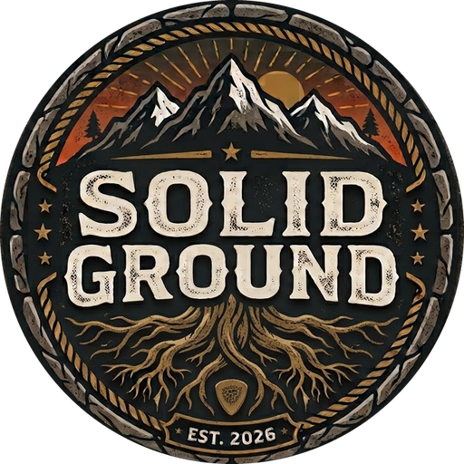
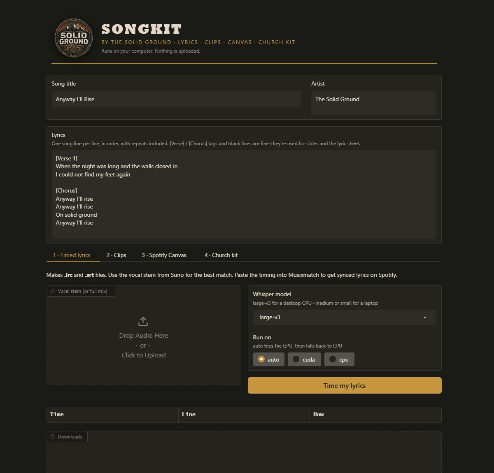

<p align="center"></p>

<h1 align="center">Songkit</h1>
<p align="center"><b>by The Solid Ground</b><br>
A free, local app for releasing your songs: timed lyrics, lyric clips, Spotify Canvas loops and church-ready lyric files.<br>
Everything runs on your own computer. Nothing is uploaded.</p>

<p align="center"></p>

---

## What it does

| Tab | You give it | You get |
|---|---|---|
| **1 · Timed lyrics** | Vocal stem + your lyrics | `.lrc` and `.srt` timed to the vocal (Whisper on your machine) |
| **2 · Clips** | Song + a few video clips | 9:16 clip for Reels/Shorts/TikTok with captions and an optional badge |
| **3 · Spotify Canvas** | A video clip | Silent 3–8s vertical loop |
| **4 · Church kit** | Your lyrics | Slides `.txt` for ProPresenter/EasyWorship + a printable lyric sheet |

Works with songs from any source, including Suno, Udio, or your own recordings.

## Install (Windows)

1. Install **Python 3.10+** from python.org (check *Add to PATH*).
2. Install **ffmpeg**: `winget install ffmpeg`
3. Double-click **`run.bat`**. The first run installs everything and opens the app in your browser.

**Mac/Linux:** `brew install ffmpeg` (or your package manager), then `./run.sh`.

### GPU or laptop?
- **NVIDIA GPU (6GB+ VRAM):** use the `large-v3` model; it takes under a minute per song.
- **Laptop / no GPU:** pick `medium` or `small`. It's slower, but works.
- If the GPU isn't set up for CUDA, the app falls back to CPU on its own.

## Workflow

1. **Title + lyrics** at the top: one sung line per line, repeats included. `[Verse]` / `[Chorus]` tags are fine.
2. **Timed lyrics:** drop in the vocal stem. Check any lines marked *estimated*.
3. **Spotify synced lyrics:** Spotify gets lyrics from [Musixmatch](https://pro.musixmatch.com). Claim your artist profile there, paste your lyrics, and sync them using your timing as a guide.
4. **Clips:** generate 3–4 short clips in Gemini/Veo or any video tool (*vertical 9:16, no music, ambient sound only*), set the start time to your chorus, and make the clip.
5. **Canvas:** upload in Spotify for Artists → your song → Canvas.
6. **Church kit:** import the slides into your presentation software; print the lyric sheet to PDF.

Output goes to `output/<song-title>/`.

## Command line

```
python songkit.py lyrics --audio vocals.wav --lyrics song.txt [--model medium]
python songkit.py clip --song song.wav --clips a.mp4 b.mp4 --srt song.srt --start 1:12 --length 30 --logo
python songkit.py clip --canvas --clips a.mp4 --out canvas.mp4
python songkit.py slides --lyrics song.txt --title "Anyway I'll Rise"
```

## AI music and honesty

If AI generated any part of your song, disclose it where your distributor asks (DistroKid: AI Credits).
Songkit makes release assets; it doesn't hide how a song was made.

## Make it yours

Replace `assets/logo.png` (square PNG, transparent background) and `assets/favicon.png` with your own art,
and change the colors at the top of `app.py`.

## License

Code: **MIT** (see `LICENSE`).
**The Solid Ground name and logo are not covered by the MIT license.** All rights reserved.
If you fork or redistribute Songkit, replace the logo with your own.
