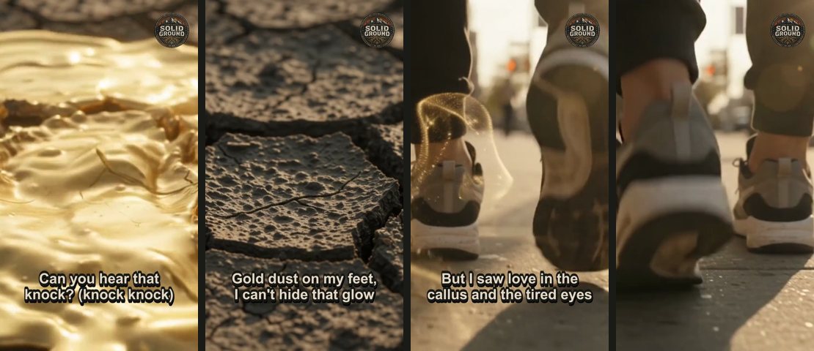

<p align="center"></p>

<h1 align="center">Songkit</h1>
<p align="center"><b>by The Solid Ground</b><br>
A free, local app for releasing your songs: timed lyrics, lyric clips, Spotify Canvas loops and church-ready lyric files.<br>
Everything runs on your own computer. Nothing is uploaded.<br>
<b><a href="https://songkit-solidground.netlify.app">songkit-solidground.netlify.app</a></b> · <a href="EXECUTIVE_SUMMARY.md">Executive summary</a></p>

<p align="center"></p>

---

## What it does

| Tab | You give it | You get |
|---|---|---|
| **1 · Timed lyrics** | Vocal stem + your lyrics | `.lrc` and `.srt` timed to the vocal (Whisper on your machine), editable in the app |
| **2 · Clips** | Song + a few video clips | 9:16 clip for Reels/Shorts/TikTok with captions and an optional badge |
| **3 · Spotify Canvas** | A video clip | Silent 3–8s vertical loop |
| **4 · Church kit** | Your lyrics | Slides `.txt` for ProPresenter/EasyWorship + a printable lyric sheet |

Works with songs from any source, including Suno, Udio, or your own recordings.

## Example: *Gold Dust Feet*

Everything below came out of Songkit from one song, a Christian hip-hop track by The Solid Ground
(words & music: Josh Leonard, AI-assisted). Files are in [`examples/gold-dust-feet`](examples/gold-dust-feet).

<p align="center">
  
  &nbsp;
  <a href="examples/gold-dust-feet/gold-dust-feet_clip.mp4"></a>
  &nbsp;
  <a href="examples/gold-dust-feet/gold-dust-feet_canvas.mp4"></a>
</p>

| Output | File | Use it for |
|---|---|---|
| Timed lyrics | [`gold-dust-feet.srt`](examples/gold-dust-feet/gold-dust-feet.srt) · [`.lrc`](examples/gold-dust-feet/gold-dust-feet.lrc) | Captions; timing guide for Musixmatch (Spotify synced lyrics) |
| Lyric clip (60s from 0:46, 9:16) | [`gold-dust-feet_clip.mp4`](examples/gold-dust-feet/gold-dust-feet_clip.mp4) | Reels, Shorts, TikTok |
| Spotify Canvas (8s loop) | [`gold-dust-feet_canvas.mp4`](examples/gold-dust-feet/gold-dust-feet_canvas.mp4) | Spotify for Artists → Canvas |
| Church slides | [`gold-dust-feet_slides.txt`](examples/gold-dust-feet/gold-dust-feet_slides.txt) | ProPresenter / EasyWorship import |
| Lyric sheet | [`gold-dust-feet_lyric_sheet.pdf`](examples/gold-dust-feet/gold-dust-feet_lyric_sheet.pdf) | Print or share with the band |

<p align="center"></p>

The background footage and cover art were made with Google Gemini (Veo / image generation) from text prompts.
Example videos are scaled to 720p to keep the repo small; Songkit itself exports 1080×1920.

## Install (Windows)

**Easiest:** go to **[songkit-solidground.netlify.app](https://songkit-solidground.netlify.app)**, click **Download**, and follow the 3 steps.

1. Download the zip and choose **Extract All**.
2. Double-click **`Install-Songkit.bat`**. It installs Python and ffmpeg if needed, sets Songkit up, and adds a desktop icon (5 to 10 minutes, one time).
3. Click **Launch Songkit** on the website, or use the desktop icon.

Your files are saved in `Documents\Songkit Songs`. To remove it: Start menu → Songkit → **Uninstall Songkit**.

**Mac/Linux:** install Python 3.10+ and ffmpeg (`brew install ffmpeg`), then run `app/run.sh`.

### GPU or laptop?
- **NVIDIA GPU:** the installer adds GPU support automatically. Use the `large-v3` model.
- **Laptop / no GPU:** pick `medium` or `small`. It's slower, but works.
- If the GPU can't be used, the app falls back to the CPU on its own.

### How the website works
The website (in `site/`, hosted on Netlify) is just the front door. **Launch Songkit** opens the app installed on your PC
through a `songkit://` link and shows it inside the page from `127.0.0.1:7860`. All processing happens on your own CPU/GPU,
and your audio never leaves your computer.

## Workflow

1. **Title + lyrics** at the top: one sung line per line, repeats included. `[Verse]` / `[Chorus]` tags are fine.
2. **Timed lyrics:** drop in the vocal stem. Check any lines marked *estimated*. Fix any wrong time or word right in the table
   (clear a line's text to remove it) and click **Save my edits**. You can also open an `.srt`/`.lrc` you made earlier to fix it.
3. **Spotify synced lyrics:** Spotify gets lyrics from [Musixmatch](https://pro.musixmatch.com). Claim your artist profile there, paste your lyrics, and sync them using your timing as a guide.
4. **Clips:** generate 3–4 short clips in Gemini/Veo or any video tool (*vertical 9:16, no music, ambient sound only*), set the start time to your chorus, and make the clip.
5. **Canvas:** upload in Spotify for Artists → your song → Canvas.
6. **Church kit:** import the slides into your presentation software; print the lyric sheet to PDF.

Output goes to `output/<song-title>/`.

## Command line

```
python app/songkit.py lyrics --audio vocals.wav --lyrics song.txt [--model medium]
python app/songkit.py clip --song song.wav --clips a.mp4 b.mp4 --srt song.srt --start 1:12 --length 30 --logo
python app/songkit.py clip --canvas --clips a.mp4 --out canvas.mp4
python app/songkit.py slides --lyrics song.txt --title "Anyway I'll Rise"
```

## Spread the word

Know a worship team, church media volunteer or indie artist who could use this? Share the website:
**[songkit-solidground.netlify.app](https://songkit-solidground.netlify.app)**.
A ready-to-post launch message is in [`docs/facebook-post.md`](docs/facebook-post.md).

## AI music and honesty

If AI generated any part of your song, disclose it where your distributor asks (DistroKid: AI Credits).
Songkit makes release assets; it doesn't hide how a song was made.

## Make it yours

Replace `app/assets/logo.png` (square PNG, transparent background), `app/assets/favicon.png` and `app/assets/songkit.ico` with your own art,
and change the colors at the top of `app/app.py`.

## License

Code: **MIT** (see `LICENSE`).
**The Solid Ground name and logo are not covered by the MIT license.** All rights reserved.
If you fork or redistribute Songkit, replace the logo with your own.
